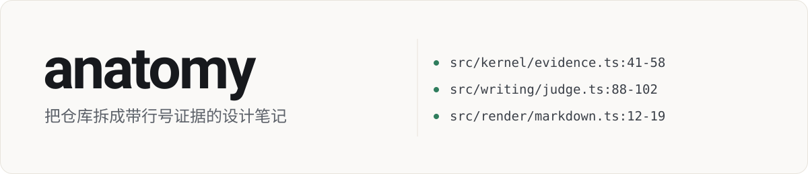

<p align="center">
  
</p>

<h1 align="center">anatomy</h1>

<p align="center">
  <a href="LICENSE"></a>
  <a href="package.json"></a>
</p>

<p align="center">
  <strong>English</strong> · <a href="README.zh-CN.md">简体中文</a> · <a href="docs/desktop.md">Desktop app</a>
</p>

Takes an open-source repository apart into **design notes backed by line-level evidence**: the decisions worth learning, what they cost, and the exact line to read. A claim that fails verification never appears in the report.

Source code is public; the scarce thing is judgement — picking the twenty decisions worth studying out of two hundred thousand lines.

**This repository is the project.** Its directory also holds unrelated work
(`emcr-pipeline`, `github-profile`); nothing outside this tree belongs to anatomy.

```bash
npm install
npm run verify        # the last line should read VERIFY: PASS
```

That is the whole check. It runs the tests, the typecheck, the build, and then the
CLI end to end against a local stub model — no API key and no network — and it
cleans up after itself. Nothing else needs to run to know the repository is sound.

`npm run audit:record` writes that verdict to `docs/superpowers/audit-output.txt`, so a
reader who cannot execute anything can still see the last recorded state and the commit
it describes.

`npm run audit` runs that gate and then states the rest of the condition — the tree
against the commit that was pushed, the documentation's numbers against the suite,
anything left as a TODO — in eight lines ending in `AUDIT: READY`.

Do not use `npm run start:desktop` or `npm run dev:*` to verify anything: they open
a window and never exit.

`npm run verify:record` runs the same gate and writes the transcript to
`docs/superpowers/verify-output.txt` with the commit, the exit code and the tree's
shape in its header — so someone who cannot execute anything can still tie the
recorded numbers to a commit.

## Desktop app

```bash
npm run start:desktop          # build the payload, then open the window
npm run start:app              # open the built bundle (out/anatomy.app), same workspace

npm run build:desktop          # payload only (dist-electron + dist-renderer)
npm run build:bundle           # assemble out/anatomy.app, a 233 MB runtime copy
npm run clean                  # remove every build artefact
```

`start:desktop` builds first, so it works from a clean tree. `dev:desktop` does not:
it expects the payload to exist and a Vite server on 5199.

Paste a repository URL into the window and the analysis runs. The model key is configured inside the app and encrypted on the machine (the renderer never sees it). The provider presets are the same set as reading-notes, including Anthropic's native protocol. Details in [docs/desktop.md](docs/desktop.md).

## Commands

`ana` below is this package's `bin`, and a plain `npm install` does not put it on
PATH. From a checkout, either run `npm link` once, or write `node dist/cli.js` where
these lines say `ana` — same program, same output.

Commands that need source:

```bash
ana scan <repo>                  # zero model calls: tells you where to look
ana analyze <repo> [--top 12]    # full analysis, writes a report
ana analyze <repo> --estimate    # price the run with the free scan; no model called
ana report <runId>               # re-render from stored artefacts (works after the tree is deleted)
ana ask <runId> "why not a list?" # answer from that report's stored evidence only
ana resume <runId>               # continue an interrupted run without re-judging
ana inspect <path:start-end>     # print one piece of evidence: the snippet the run stored
ana doc <runId>                  # architecture notes from a verified report, with a Mermaid diagram
ana export <runId>               # the whole dossier: summary, decisions, risks, onboarding, quiz
ana history <runId>              # last commit behind each cited file (local checkouts)
```

Commands that do not need source (the reconstructed ones use [REA](https://github.com/morluto/rea)) — no model called at all:

```bash
ana inspect-app <dir>            # reconstruct from shipped artefacts: modules, IPC, contextBridge, storage
ana app-report <name>            # the facts report for one application
ana app-diff <a> <b>             # what changed on the boundary between two builds
ana runs [--json]                # list stored analyses: date, source, points
ana forget <id> [--app]          # delete one stored analysis
ana forget --keep 3              # keep the three newest, delete the rest
ana diff <a> <b>                 # compare two stored analyses: numbers and point titles
ana mcp                          # serve the facts over MCP on stdio
```

`ana mcp` exposes `anatomy_scan`, `anatomy_report`, `anatomy_evidence`,
`anatomy_forget` and the opt-in `anatomy_ask` as MCP tools — the facts, not the judgement, plus the delete that
keeps a long session from littering `.ana/runs`. The first four call no model and read no key, so an agent that already has a model
can take the evidence and do the writing itself. `anatomy_ask` spends the server
environment's key, and refuses unless the caller passes `spend: true` — an MCP
server that quietly bills the caller's provider is a bad guest, so `analyze` is
still deliberately absent.

`inspect-app` needs Node ^22.23.4 || ^24.22.1 || >=26.12.1 and a `rea` it can run
(`npx rea-agents setup`, or point `ANA_REA` at its `scripts/rea.mjs`). A whole
application takes minutes; `--path preload.cjs` analyses only the small files that
declare the boundary, usually in a second or two.

`<repo>` is a GitHub URL, any tarball URL, or a local directory. It analyses the latest release tag by default; `--ref` overrides it, `--subpath` narrows a monorepo to one subtree.

A real run needs model credentials:

```bash
export ANA_MODEL=gpt-4o-mini  ANA_API_KEY=sk-...
node dist/cli.js analyze https://github.com/sindresorhus/quick-lru --top 8
```

## What a report looks like

The opening of a real run (`sindresorhus/quick-lru`), report body in Chinese:

```markdown
# quick-lru

## 这次分析在解决什么

一个小型工具库，用语言内建结构替代显式的数据结构。

## 最值得学的 1 件事

1. 用插入顺序维护淘汰顺序，不额外维护链表

## 这次分析的可信度

- 已取证点占比：100.0%
- 被丢弃证据数：0
- 每点平均证据数：1

## 分析口径

- 来源：https://github.com/sindresorhus/quick-lru
- 规模：13 个文件 / 62687 字节 / 2606 行
```

Every point in the body carries a locator such as `index.js:1-1` and a verbatim snippet. The report always ends with "what I did not read", listing unsupported languages, candidates dropped by the budget, and withheld points.

## Two invariants

The whole value of the product rests on these two, and the code is organised around them:

1. **No fabrication.** Everything the model writes is a claim pending verification. `src/kernel/evidence.ts` compares the snippet against the bytes on disk, and `src/writing/judge.ts` rejects any line number the model was never shown. Only what passes both reaches the page.
2. **The analysed repository is never executed.** No `git clone`, no dependency install, no scripts. Python is parsed with `ast`; the sidecar starts with `-I` and a sanitised environment so a repository cannot shadow the standard library with its own `ast.py`.

## Structure

```
src/kernel/     LLM-free forensic kernel: acquire, profile, structure map, signals, evidence check, budget
src/writing/    the only layer that spends tokens: prompts, judge, ranking, synthesis
src/render/     one dataset, two renderings: narrative + collapsible recipe, and JSON
src/app/        REA adapter: the call, its progress, fact grouping, diffs
src/commands/   scan / analyze / report / ask / resume / diff / doc / export / history / inspect / inspect-app / app-report / app-diff / forget / mcp / runs
eval/           gold set and recall scripts (npm run eval)
```

## Known blind spots

29 gold repositories, 90 annotated points, current candidate recall **61%**.

Which means roughly four annotated points in ten never become candidates at all, and no model can write about a line it was never shown. The number stays in the repository because that is more useful than hiding it:

```bash
npm run eval:recall
```

`docs/superpowers/recall-lite.txt` is a dated snapshot of one such run, per repository — including the previous 46% it improved from.

## Release status

`0.1.0` — the first version whose reports are worth reading. The window shows a
report, copies its markdown, reveals the file, lists history, compares two surveys,
and scans a repository without spending tokens. Not on npm: `ana` runs
from a checkout (`npm run build && node dist/cli.js …`). The MCP server is in this
version; `publish` is not.

`package.json` carries a `files` list, so if it is ever published the tarball is
`dist/` plus the READMEs and LICENSE — 116 files, not the 336 a bare `npm pack`
picked up (73 test files, 64 eval fixtures). A test asks `npm pack --dry-run` rather
than trusting the field.

`dependencies` holds two packages, `tokenx` and `typescript`, because those are what
the shipped code imports. It used to hold `electron`, `vite`, `react`, `react-dom`
and three `@types` packages: the whole desktop toolchain, downloaded by anyone who
installed a CLI. Verified by installing the tarball into an empty project — three
packages, and `ana scan` works.

## What this version is

One unambiguous statement, so nothing is left pending a decision:

- sixteen commands, all usable; `npm run verify` is the single gate (879 tests, three
  tsconfigs, and the CLI end to end against a local stub model)
- a repository **with** source: design notes where every claim cites a line and is
  checked against the bytes on disk; anything unverifiable never reaches the page
- an application **without** source: facts report and a two-build diff through REA,
  with no model called at all
- complete reports in Chinese and English, frame and prose alike
- **`ana export`** turns one analysis into a dossier — summary, decisions, risks, onboarding (entry points, hubs and directories), hotspots and a self-check — with zero extra model calls by default; **`ana doc`** writes a repository-facing `ARCHITECTURE.md` with a reading order and a derived Mermaid diagram, plus an optional portable bundle; **`ana history`** adds the last commit behind each cited file for local checkouts; Go gets a line-oriented structure pass.
- **follow-up questions** answered only from the report's stored evidence; **resume** reuses judged candidates; a second analysis of the same tree reuses the judge checkpoint (`--no-cache` turns it off); every run records its model calls and tokens in `usage.json`

Recall is 61% on the tracked gold set with every candidate; the default 12-candidate
budget covers 53.3%. The difference is measured in `docs/superpowers/judge-cost.md`:
18 more candidates buy 2.3 points for roughly 2.5× the judge cost.

## Not built yet

- **`ana publish`** — a hosted report. Deliberately not built: the report is
  evidence-bound, and hosting it invites a reader to treat it as a page rather than
  a document with citations. Deferred, not rejected.
- Structure analysis for languages other than TypeScript/JavaScript, Python and Go. Go gets a line-oriented import/declaration pass, not a parser; the other languages remain unsupported.
- **A judgement report for an application without source.** REA reconstructs what
  the code does; inferring why it was designed that way needs a second verifier
  (against `evidence_id` rather than bytes on disk), and until that exists the
  honest output is the facts report.

Design, plan and execution records live in `docs/superpowers/PROGRESS.md`.
