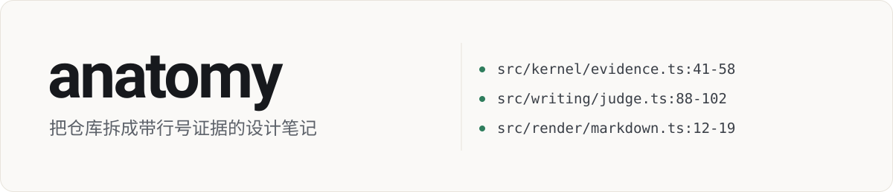

<p align="center">
  
</p>

<h1 align="center">anatomy</h1>

<p align="center">
  <a href="LICENSE"></a>
  <a href="package.json"></a>
</p>

<p align="center">
  <a href="README.md">English</a> · <strong>简体中文</strong> · <a href="docs/desktop.md">桌面应用</a>
</p>

把一个仓库拆成一份**带行号证据的设计笔记**：值得学的决定、它们的代价、以及证据在哪一行。验证不过的说法不会出现在报告里。

源代码是公开的，稀缺的不是代码，是判断力——从二十万行里挑出二十个真正值得学的决定。

**本仓库即项目。** 它所在的工作区里还有无关的 `emcr-pipeline` 与 `github-profile`；
anatomy 不含这份源码树之外的任何东西。

```bash
npm install
npm run verify        # 末行应为 VERIFY: PASS
```

这一条就够了：它跑测试、类型检查、构建，然后用本地假模型把 CLI 端到端走一遍，
不需要 Key、不需要外网，跑完自己清理。判断这个仓库是否健康，不需要再跑别的。

`npm run audit` 在这个闸门之上再陈述其余的状态——工作区是否就是推上去的那个提交、
文档里的数字是否还对得上测试、有没有留下 TODO——八行，最后一句是 `AUDIT: READY`。

**不要用 `npm run start:desktop` 或 `npm run dev:*` 来验证任何东西**——它们会开一个窗口
然后一直不退出。

`npm run verify:record` 跑同一道闸门，并把转录写进 `docs/superpowers/verify-output.txt`，
头部带上提交、退出码和当时树的样子——所以一个**没法执行任何命令**的人，也能把记录里的数字
钉到一个提交上。

## 桌面应用

```bash
npm run start:desktop          # 先构建载荷，再开窗口

npm run build:desktop          # 只构建载荷（dist-electron + dist-renderer）
npm run build:bundle           # 组装 out/anatomy.app（233MB 的运行时副本）
npm run clean                  # 清掉全部构建产物
```

`start:desktop` 会先构建，所以从干净的工作区也能直接跑。`dev:desktop` 不会：它要求载荷
已经存在，且 5199 上有一个 Vite 服务。

窗口里填一个仓库地址就能跑分析，模型 Key 在应用内配置（加密存在本机，
渲染进程拿不到）。provider 预设与 reading-notes 同一套，含 Anthropic 原生协议。
细节见 [docs/desktop.md](docs/desktop.md)。

## 命令

下面的 `ana` 是这个包的 `bin`，而 `npm install` 不会把它放进 PATH。在检出目录里
先 `npm link` 一次，或者把下面的 `ana` 换成 `node dist/cli.js`——同一个程序，同样的输出。

需要有源码的四条：

```bash
ana scan <repo>                  # 零模型调用：告诉你哪里最值得看
ana analyze <repo> [--top 12]    # 完整分析，产出报告
ana report <runId>               # 用已存产物重渲染（分析树已删也能出）
ana inspect <path:起止行>        # 打印某条证据的原文片段（报告里的引用可直接粘）
```

没有源码也行的四条（走 [REA](https://github.com/morluto/rea) 取证，全程不调模型）：

```bash
ana inspect-app <dir>            # 从打包产物重建：模块、IPC、contextBridge、存储关系
ana app-report <name>            # 单份事实报告
ana app-diff <a> <b>             # 两份的差异：暴露面变了什么
ana runs [--json]                # 列出存下来的分析：日期、来源、点数
ana forget <id> [--app]          # 删掉一份存下来的分析
ana forget --keep 3              # 只留最新的三轮，其余删掉
ana mcp                          # 把确定性的一半以 MCP 挂在 stdio 上
```

`ana mcp` 提供 `anatomy_scan`、`anatomy_report`、`anatomy_evidence`、`anatomy_forget`
四个工具——给的是事实，不是判断；加上删除工具，长时间会话才不至于把 `.ana/runs` 堆满。不调模型、不读 Key，所以已经有模型的一方可以拿证据自己写。**故意不暴露
`analyze`**：一个会悄悄花掉调用方额度的 MCP 服务是坏客人。

`inspect-app` 需要 Node ^22.23.4 || ^24.22.1 || >=26.12.1 和一个可用的 `rea`
（`npx rea-agents setup`，或用 `ANA_REA` 指向它的 `scripts/rea.mjs`）。
整个应用跑一次要几分钟，用 `--path preload.cjs` 只分析声明了边界的那几个小文件，
通常一两秒。

`<repo>` 可以是 GitHub 地址、任意 tarball 地址，或本地目录。默认分析最新 release tag，`--ref` 覆盖，`--subpath` 限定 monorepo 的某棵子树。

真机运行需要模型凭据：

```bash
export ANA_MODEL=gpt-4o-mini  ANA_API_KEY=sk-...
node dist/cli.js analyze https://github.com/sindresorhus/quick-lru --top 8
```

## 报告长什么样

真实运行（`sindresorhus/quick-lru`）的开头：

```markdown
# quick-lru

## 这次分析在解决什么

一个小型工具库，用语言内建结构替代显式的数据结构。

## 最值得学的 1 件事

1. 用插入顺序维护淘汰顺序，不额外维护链表

## 这次分析的可信度

- 已取证点占比：100.0%
- 被丢弃证据数：0
- 每点平均证据数：1

## 分析口径

- 来源：https://github.com/sindresorhus/quick-lru
- 规模：13 个文件 / 62687 字节 / 2606 行
```

正文里每个点都带 `index.js:1-1` 这样的定位和逐字片段；末尾必有「没看的部分」，列出不支持的语言、被预算裁掉的候选、以及被 withheld 的点。

## 两条不变量

产品的全部价值压在这两条上，代码里也按这两条组织：

1. **不编造。** 模型写的一切都是待验证的主张。`src/kernel/evidence.ts` 拿片段去比对磁盘上的字节，`src/writing/judge.ts` 还会拒绝引用它从未展示给模型的行号——两者都过，才会出现在页面上。
2. **不执行被分析仓库的代码。** 不 `git clone`、不装依赖、不跑脚本；Python 用 `ast` 解析，sidecar 以 `-I` 启动并清洗环境，避免被分析仓库的 `ast.py` 之类顶替标准库。

## 结构

```
src/kernel/     无 LLM 的取证内核：取仓库、口径、结构图、信号、证据校验、预算
src/writing/    唯一花 token 的一层：提示、judge、排序、综述
src/render/     一层数据两种渲染：叙述 + 可折叠配方、以及 JSON
src/app/        REA 适配：调用、进度、事实归类、两份对比
src/commands/   scan / analyze / report / inspect / inspect-app / app-report / app-diff / forget / mcp / runs
eval/           gold 集与召回率脚本（npm run eval）
```

## 知道自己会看漏

29 个 gold 仓库、90 个标注点，当前候选召回率 **61%**。

也就是说约四成的标注点连候选都没进，模型再强也写不出来。这个数字留在仓库里，比藏起来有用：

```bash
npm run eval:recall
```

`docs/superpowers/recall-lite.txt` 是其中一次的带日期快照，逐仓库列出——也包括它从 46% 涨上来的那一版。

## 发布状态

`0.1.0` —— 第一个报告值得读的版本。没有发到 npm：`ana` 从 checkout 跑
（`npm run build && node dist/cli.js …`）。MCP server 在这一版里，`publish` 不在。

`package.json` 带 `files` 列表，所以万一发布，tarball 是 `dist/` 加两份 README 和
LICENSE——116 个文件，而不是裸 `npm pack` 会装进去的 336 个（73 个测试文件、
64 个 eval 样本）。有测试直接问 `npm pack --dry-run`，而不是相信那个字段。

`dependencies` 只有两个包：`tokenx` 和 `typescript`——因为发布出去的代码只 import 这两个。
它一度还包含 `electron`、`vite`、`react`、`react-dom` 和三个 `@types`：整套桌面工具链，
会被每一个只是想装个 CLI 的人下载。验证方式是把它装进一个空项目：3 个包，`ana scan` 正常。

## 这一版是什么

一句话说清，不留悬空：

- 十条命令都可用；`npm run verify` 是唯一闸门（777 个测试、三套 tsconfig、CLI 端到端
  跑假模型）
- **有源码**的仓库：产出带行号证据的设计笔记，每条主张都对着磁盘字节核对过，
  核对不过就不进正文
- **没有源码**的应用：经 REA 出事实报告与两份差异，全程不调模型
- 中文与英文的完整报告，骨架和正文都是

召回率在跟踪的 gold 集上是 61%，这既是这一版的实测值，也是它的上限：十个专家标注点里
有四个连候选都进不去。

## 未做

- **`ana publish`** —— 托管版报告。故意没做：报告是绑在证据上的，托管出去会诱导读者把它
  当成一个页面而不是一份带引用的文档。是延后，不是否决。
- 其他语言的结构分析：目前只认 TS/JS 与 Python。
- 无源码应用只能出**事实报告**，还没有判断版：从重建图推「为什么这么设计」需要第二个
  校验器（对 `evidence_id` 而不是磁盘字节），没做之前宁可不写。

设计、计划与执行记录见 `docs/superpowers/PROGRESS.md`。
